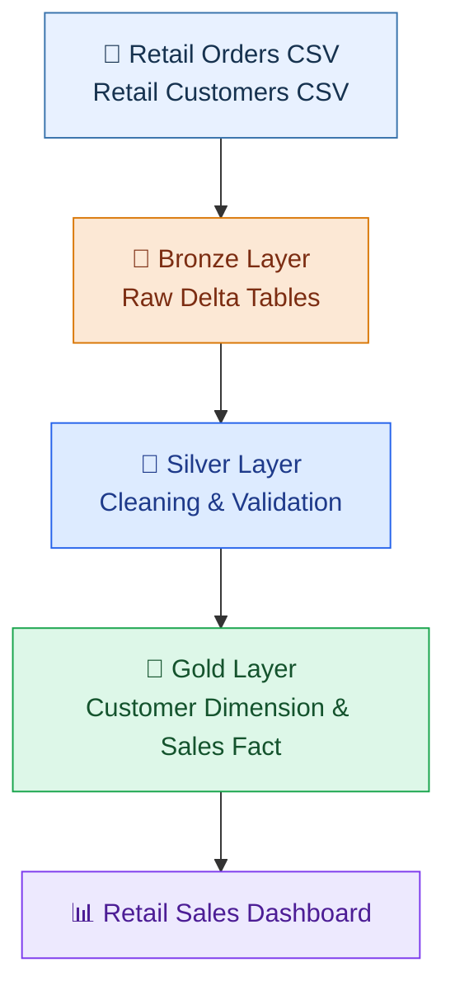

# 🛍️ Retail Sales Analysis | Databricks Medallion Architecture

<p align="center">
  
  
  
  
</p>

<p align="center">
  <b>An end-to-end retail data engineering project built with Databricks and PySpark.</b>
  <br/>
  Transforming messy retail orders and customer data into structured, analytics-ready datasets.
</p>

---

## 📌 Project Overview

This project implements the **Medallion Architecture in Databricks** to process retail orders and customer datasets containing inconsistent values, duplicate records, mixed date formats, and data quality issues.

Using PySpark and Delta tables, I built a data pipeline that ingests raw CSV files, cleans and standardizes the data, integrates customer and order information, and prepares aggregated datasets for retail sales analysis.

The project also includes a retail sales dashboard that explores category revenue, daily revenue trends, customer gender distribution, and top products by revenue.

## 📊 My Retail Sales Dashboard

### Dashboard 1 — Category Revenue & Daily Sales Trends


### Dashboard 2 — Customer Analysis & Top 10 Products


---

## 🏗️ Medallion Architecture

The project follows three data processing layers:

**Bronze → Silver → Gold**

### 🥉 Bronze Layer — Raw Data Ingestion

**Objective:** Ingest the original datasets into Databricks and preserve the source data as the starting point for processing.

**What I implemented:**
- Loaded the retail orders and customer CSV files from Databricks Volumes.
- Defined explicit PySpark schemas for both datasets.
- Read source data using PySpark DataFrames.
- Added an `ingest_time` timestamp to track data ingestion.
- Stored the datasets as Delta tables.

**Tables created:**
- `retail_project.bronze.bronze_order`
- `retail_project.bronze.bronze_customer`

### 🥈 Silver Layer — Data Cleaning & Transformation

**Objective:** Improve data quality and standardize inconsistent records before analysis.

**Orders data transformations:**
- Parsed order dates from multiple formats.
- Standardized category names, including `ELECTRONIC` to `ELECTRONICS`, `FASHON` to `FASHION`, and `HOME AND LIVING` to `HOME & LIVING`.
- Checked duplicate order IDs and removed duplicates.
- Handled missing discount values and the text value `ten`.
- Converted percentage discounts into decimal values.
- Handled negative quantities.
- Converted unit prices into decimal data types.
- Recalculated `total_amount` using quantity, unit price, and discount.

**Customer data transformations:**
- Trimmed unwanted spaces from customer fields.
- Removed duplicate customers using a window function and retained the most recently ingested record per customer ID.
- Standardized customer status to `ACTIVE`, `INACTIVE`, or `UNKNOWN`.
- Cleaned loyalty points and converted them into integer values.
- Validated email formats using a regular expression.
- Parsed date of birth and registration dates from multiple formats.
- Standardized gender values to `M`, `F`, or `U`.

**Tables created:**
- `retail_project.silver.silver_order`
- `retail_project.silver.silver_customer`

### 🥇 Gold Layer — Business-Ready Data

**Objective:** Combine the cleaned data and prepare it for reporting and business analysis.

**What I implemented:**
- Created a customer dimension containing customer ID, name, email, city, state, loyalty points, and status.
- Joined order data with customer data using `customer_id` and a left join.
- Enriched orders with customer and geographic attributes.
- Extracted `Year`, `Month`, and `Day` from the order date.
- Aggregated sales metrics using PySpark functions.

**Tables created:**
- `retail_project.gold.gold_dim_customer`
- `retail_project.gold.gold_fact_sales`

**Metrics calculated in the Gold dataset:**
- Total revenue
- Total quantity
- Distinct order count
- Average revenue
- Average quantity
- Average loyalty points
- Minimum unit price
- Maximum unit price

---

## 🔄 Data Pipeline



## 📈 Dashboard Insights & Visualizations

The dashboard screenshots show the following analyses:

| Visualization | What it shows |
|---|---|
| Revenue by Category | Compares total revenue across Electronics, Fashion, and Home & Living |
| Daily Revenue Trend | Tracks total revenue across order dates |
| Customer Data Table | Displays city-level customer and sales metrics |
| Total Orders by Gender | Shows the distribution of orders across gender categories, including unknown values |
| Top 10 Products by Revenue | Ranks products by their total revenue |

The dashboard also includes filters for **Year, Gender, and Category** to explore the data interactively.

## 🛠️ Technology Stack

| Technology | Purpose |
|---|---|
| Databricks | Data engineering workspace |
| PySpark | Data cleaning, transformation, joins, and aggregation |
| Delta Lake | Structured data storage |
| Python | Data processing logic |
| GitHub | Source control and project documentation |

## 📂 Repository Structure

```text
Databricks-sales-Analysis/
│
├── Retail_sales_project_databricks.ipynb
├── dashboard.json
├── README.md
└── images/
    ├── retail-sales-dashboard-1.png
    └── retail-sales-dashboard-2.png
```

*The image filenames are used by this README. Upload your actual dashboard screenshots using these exact names. Keep `dashboard.json` if it is your exported dashboard definition.*

## 🚀 How to Run the Project

1. Clone the repository or connect it to Databricks using Git folders.
2. Upload the source CSV files to an accessible Databricks Volume.
3. Verify the catalog, schema, permissions, and file paths.
4. Run the notebook cells in order, starting with the Bronze layer.
5. Review the Silver tables and data quality transformations.
6. Generate the Gold customer dimension and sales fact table.
7. Open the dashboard in Databricks or import the dashboard definition into a compatible dashboard interface.

## 🎯 Key Learnings

- Implementing the Medallion Architecture in Databricks.
- Processing messy data with PySpark.
- Cleaning and standardizing real-world data.
- Using window functions for deduplication.
- Working with Delta tables and schemas.
- Joining customer and order datasets.
- Aggregating sales metrics for business intelligence.
- Building dashboard visualizations for retail analysis.

---

<p align="center">
  <b>Created by Bhoomi Dubey</b>
  <br/>
  <i>Data Science | Data Engineering | Retail Analytics</i>
  <br/><br/>
  <b>Built with ❤️ using Databricks and PySpark</b>
</p>
